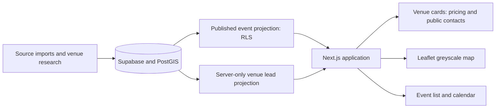

# GATHR

### Find a space. Check the costs. Bring your community together.

GATHR helps London community organisers discover venue leads, read the recorded pricing, find a public contact or booking page, and explore locations on a greyscale map.

**[Product walkthrough](docs/WALKTHROUGH.md)** · **[Venue costs and contacts](docs/VENUE_DIRECTORY.md)** · **[Map setup](docs/MAP_SETUP.md)** · **[MIT licence](LICENSE)**

## What you can do

- **Find venues:** search by name, neighbourhood, address or postcode; filter by cost type, capacity and public contact availability.
- **See the costs:** read source pricing notes, including session rates, minimum spends and quote-on-request information. Missing prices remain unknown.
- **Contact the venue:** follow public contact, booking and website links. Private organiser contacts are excluded.
- **Explore the map:** locate venues and events on an interactive Leaflet map with a greyscale OpenStreetMap basemap. Optional CARTO Positron support is configured with a basemap key.
- **Browse events:** view published community event records, filter upcoming events on the map, and export a calendar feed.
- **Inspect provenance:** follow original source links and see which records are imported leads rather than verified hire offers.

## Current data snapshot

Checked against the running application's APIs on **22 October 2026**:

| Content | Records |
| --- | ---: |
| Venue leads | 104 |
| Venues with a public contact, booking or website link | 78 |
| Published events | 447 |

These are snapshots, not fixed product totals. Counts may change as imports and research continue. A non-demo record is not automatically verified. Imported venue leads retain their pending review status and are labelled **unverified**.

Pricing is indicative source information, not a live quote or confirmed availability. The current records store their rates as descriptive notes; there are no populated numeric total-booking prices. The advanced numeric budget filter therefore excludes those textual rate cards instead of guessing comparable totals.

## Walk through the product

1. Open the app and select **Find a venue**.
2. Search for an area or a venue such as **Alphabeta**.
3. Read the grey pricing box beneath its address.
4. Use **Contact venue**, **Booking / hire details**, or **Venue website** to check terms directly.
5. Select **View on map** to locate the venue.
6. Explore community events and switch the map to **Upcoming events** when planning a future gathering.

The [full walkthrough](docs/WALKTHROUGH.md) explains each screen and the difference between a venue lead, a price note and a confirmed booking.

### Screenshots

Genuine product screenshots have not yet been added. Capture is blocked by a saved browser-access permission for the local site, including after the permission-change confirmation. No mockups are presented as screenshots. The [capture checklist](docs/SCREENSHOT_PLAN.md) records the intended hero and walkthrough frames.

## Run locally

Requires Node.js 22+ and npm. The repository is source code, not a public hosting deployment.

```sh
git clone https://github.com/deneshashok/gathr.git
cd gathr
npm ci
cp .env.example .env
```

For the current Supabase-backed map and venue directory, configure the existing normalised project in `.env`:

```dotenv
SUPABASE_CATALOGUE_ENABLED=true
SUPABASE_URL=https://your-project.supabase.co
SUPABASE_ANON_KEY=your-publishable-key
SUPABASE_SECRET_KEY=your-server-secret-key
```

The publishable key reads the published event catalogue through database RLS. The server secret is used only for the restricted venue-lead projection; it is never sent to the browser. `.env` is ignored by Git. An empty `CARTO_BASEMAP_KEY` selects the greyscale OpenStreetMap fallback.

```sh
npm run build
node --env-file=.env node_modules/next/dist/bin/next start --hostname 127.0.0.1
```

Open [localhost:3000](http://127.0.0.1:3000). For development, `npm run dev` is also available.

**Database setup:** the connected Supabase schema was expanded beyond the original JSON-store bootstrap. The original migration alone does not recreate every normalised table/column required by the current read projections. Review [Supabase setup](docs/SUPABASE_SETUP.md), [map setup](docs/MAP_SETUP.md) and [venue directory](docs/VENUE_DIRECTORY.md) before applying migrations to another project. This repository does not claim a fully reproducible fresh-project migration chain yet. The modern catalogue is read-only in this app; contribution and review writes need the matching organiser workflow.

## How it works



| Layer | Technology |
| --- | --- |
| App | Next.js App Router, React, Tailwind CSS, Radix/shadcn-style components |
| Database | Supabase PostgreSQL and PostGIS |
| Map | Leaflet 1.9.4, OpenStreetMap tiles; optional CARTO Positron |
| Event formats | Public Event JSON-LD and ICS adapters |
| Verification | Node test runner and API smoke checks |

Private submissions, rejected listings, demo records and unsupported pending sources are excluded from the public directory projection. Imported venue leads can be displayed without promoting them to approved venues. No booking, payment or venue availability is inferred from an event taking place there.

## Tests

```sh
npm test
npm run build
```

With a configured running app and existing remote records:

```sh
node --env-file=.env scripts/smoke-venues.mjs
node --env-file=.env scripts/smoke-map.mjs
```

The latest application verification passed **27 unit tests**, the production build and both API smoke checks. Browser visual verification and screenshots remain blocked by the saved origin permission. API success is not described as visual verification.

## Documentation

| Guide | Purpose |
| --- | --- |
| [Walkthrough](docs/WALKTHROUGH.md) | Venue search, prices, contacts, map and event calendar |
| [Venue directory](docs/VENUE_DIRECTORY.md) | Imported leads, price handling, public contact projection |
| [Map setup](docs/MAP_SETUP.md) | Geolocations, missing coordinates and basemap configuration |
| [Supabase setup](docs/SUPABASE_SETUP.md) | Database access, schema status and permissions |
| [Adapter architecture](docs/ADAPTERS.md) | Data format adapters, provenance and limitations |
| [Build history](docs/BUILD_HISTORY.md) | Earlier source checks, environment constraints and implementation notes |

## Licence

Application code is [MIT licensed](LICENSE). Third-party datasets and map tiles retain their own licences and attribution requirements. OpenStreetMap attribution is visible on the map; CARTO attribution is also shown when its basemap is used.
